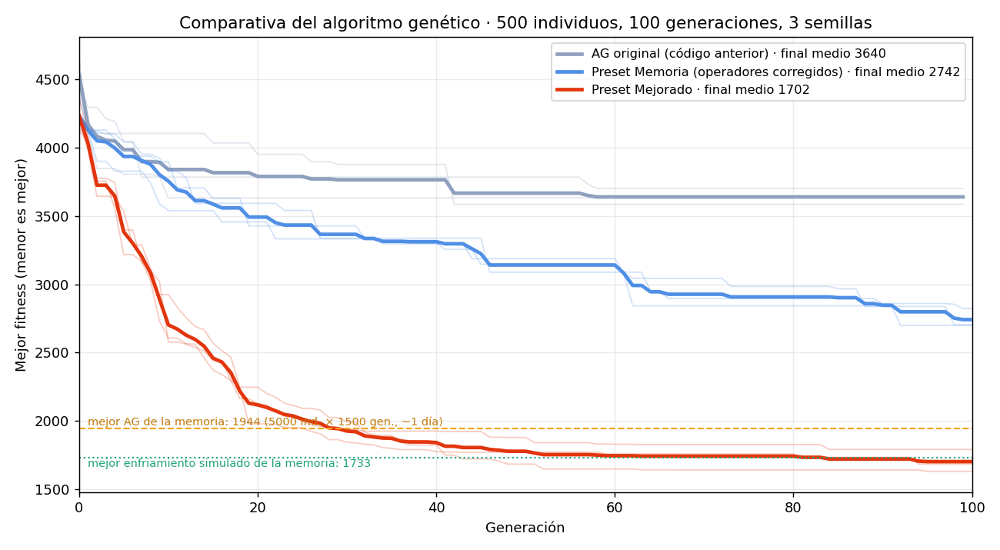

# IA-plays-conceptual-pkm-redfire
This is a work from my Master's degree in Artificial Intelligence applying metaheuristic techniques to generate a solution to a Nuzlocke run in a version of Pokémon FireRed, with deterministic or random (accuracy, critical hits, damage rolls) battles.

Un **algoritmo genético** busca la mejor ruta *nuzlocke* de Rojo Fuego: qué Pokémon capturar en cada una de las 36 zonas (una captura por zona), qué equipo usar en cada uno de los 21 combates principales y en qué orden sacarlo, y, de forma opcional, cuándo cambiar de Pokémon durante el combate. El fitness es el % de HP perdido en los 21 combates simulados, más 10000 por cada derrota; cuanto menor, mejor. Los combates pueden simularse como en la memoria (deterministas) o con aleatoriedad real: precisión, críticos y tiradas de daño, con el fitness como media sobre escenarios fijos (ver [Combates aleatorios](#combates-aleatorios)). La memoria del trabajo está en `MTH_PKM.pdf`.



## Instalación

1. **Python** (3.10 o superior):

   ```
   python -m pip install -r requirements.txt
   ```

2. **Servidor de cálculo de daño** (Node.js, usa `@smogon/calc`):

   ```
   cd damage_calculator
   npm install
   ```

3. **Datos de los Pokémon** (no están versionados). Se descargan de PokéAPI con `python pkm_data/data_fetcher.py`, ejecutado desde la raíz del proyecto, en este orden de opciones: `4` (movimientos), `1` (Pokédex), `5` (evoluciones), `2` (sprites animados) y `3` (normalizar sprites).

4. **Tabla de daños.** Precalcula todas las combinaciones de ataque (~9700, 0,44 MB) en unos segundos. A partir de entonces el algoritmo no necesita el servidor (ver [Tabla de daños](#tabla-de-daños)):

   ```
   node damage_calculator/servidor.js        # en otra terminal
   python tools/precompute_damage.py
   ```

   También se puede hacer desde la interfaz, con el botón *Precalcular tabla* de la barra superior. Para los combates aleatorios hace falta además la tabla de tiradas (todos los movimientos, 2,5 MB): `python tools/precompute_damage.py --rolls`.

## Uso

### Interfaz gráfica

```
python app.py
```

La ventana tiene una barra superior, un menú lateral con tres vistas (**Entrenar**, **Visor** y **Ejecuciones**) y la vista activa. Al abrirla, el visor carga el primer individuo de los ejemplos.

#### Barra superior

| Elemento | Qué hace |
|---|---|
| *Tabla de daños N %* | Porcentaje de combinaciones de ataque precalculadas en `pkm_data/damage_dictionary.json` (tabla del simulador determinista). El *tooltip* da el número exacto. |
| *Servidor activo / apagado* | Si responde el servidor de daños (`node damage_calculator/servidor.js`). No hace falta cuando la tabla está completa. |
| *Precalcular tabla* | Solo aparece si la tabla está incompleta y el servidor está activo: calcula todas las combinaciones que faltan. |
| *Comprobar* | Vuelve a comprobar la tabla y el servidor. |

La tabla de tiradas de los combates aleatorios (`damage_rolls.json`) se genera por línea de comandos: `python tools/precompute_damage.py --rolls`.

#### Entrenar

Lanza el algoritmo genético en un proceso aparte y muestra su evolución en directo. Tiene tres columnas.

**Columna izquierda: ejecución y configuración**

*Tarjeta Ejecución*
- **Botones:** *▶ Entrenar*, *⏸ Pausar* (cambia a *▶ Continuar*) y *■ Detener*. Detener guarda un checkpoint para reanudar la ejecución desde *Ejecuciones*.
- **Barra de progreso** y generación actual.
- **Tiempo** transcurrido y tiempo restante estimado.
- **Velocidad:** evaluaciones por segundo, aciertos de la caché de combates y porcentaje de genotipos únicos.
- **Carpeta** donde se guarda la ejecución (`runs/<fecha>_<preset>/`).

*Configuración.* Cada campo tiene su explicación en el *tooltip*. Al cambiar cualquier valor, el preset pasa a *Personalizado*.

| Grupo | Campos |
|---|---|
| Configuración | *Algoritmo* (genético; el enfriamiento simulado aparece deshabilitado porque es experimental) y *Preset*: Memoria, Mejorado, Aleatorio, Rápido o Personalizado. |
| Población | *Individuos (POB)*, *Generaciones* y *Semilla* (o *Aleatoria*). |
| Selección | *Método* (ruleta por rango o torneo), *Tamaño torneo (k)* y *Padres (SEL)*. |
| Operadores | *Cruce (CRUCE)*, *Mut. capturas*, *Mut. equipos*, *Mut. orden*, *Mut. plan* (solo con cambios) e *Hijos por pareja*. |
| Reemplazo | *Supervivientes (SUP)*, *Completar con* (individuos aleatorios, como en la memoria, o hijos + inmigrantes) e *Inmigrantes*. |
| Opciones | Casillas *Permitir cambios de Pokémon*, *Inicialización por tipos*, *Modos exploración/explotación* y *Penalización graduada*; *Escenarios aleatorios* (*Determinista* = simulador de la memoria; 100 = combates aleatorios de 3.ª generación); *Procesos* que evalúan en paralelo. |

**Columna central: gráficas**
- **Evolución del fitness:**
  - líneas: mejor global (amarillo), mediana de la población (azul) y mejor de cada generación (gris discontinuo);
  - banda p10-p90 de la población y una marca en cada récord;
  - casilla *Escala logarítmica*.
- **Pestaña *Combates del mejor*:** mapa de calor de 21 combates × generaciones con el HP que pierde el mejor individuo en cada combate. Las derrotas salen en oscuro; al pasar el ratón se ven la generación, el combate y el valor.
- **Pestaña *Población*:** nube de puntos con el fitness de cada individuo por generación (muestra de 300), coloreada según su origen: inicial, superviviente, cruce, mutación o aleatorio.
- **Pestaña *Diversidad y victorias*:**
  - curvas de genotipos únicos, distancia media entre capturas y porcentaje de individuos que completan el juego (21/21);
  - histograma de victorias en la población.

**Columna derecha: resultados**
- **Campeón actual:**
  - fitness y victorias (con combates aleatorios: probabilidad de completar la ruta);
  - generación en que apareció, origen y HP perdido;
  - equipo de la Liga animado;
  - botón *Abrir en el visor*.
- **Récords:** cada mejora con su generación, el nuevo fitness, la mejora respecto al anterior, el origen y las victorias.
- **Hall of Fame:** los 50 mejores individuos únicos (fitness, victorias, generación y origen). Doble clic para abrir uno en el visor.

Si se cierra la ventana con un entrenamiento en marcha, pide confirmación, lo detiene y guarda un checkpoint.

#### Visor

Muestra un individuo: sus capturas, sus equipos y la repetición de sus 21 combates.

**Barra del visor**
- **Ejemplos ▾:** individuos de `examples/individuals.json`.
- **Abrir JSON…:** un individuo exportado, el `best.json` de una ejecución o su `hall_of_fame.json` (abre el primero).
- **Pegar genotipo…:** `[[capturas], [equipos]]`, con planes de cambios `[[capturas], [equipos], [planes]]`, o el JSON de un individuo.
- **Exportar JSON…:** guarda el individuo con su evaluación.

Junto al título se indica de dónde viene el individuo.

**Cabecera**

| Elemento | Con la tabla de tiradas | Sin ella |
|---|---|---|
| Tarjeta 1 | Fitness (media de los 100 escenarios del entrenamiento) | Fitness determinista |
| Tarjeta 2 | Completa la ruta: % de escenarios en que gana los 21 combates | Combates ganados (x/21) |
| Tarjeta 3 | % HP perdido en total (media) | % HP perdido en total |
| Tarjeta 4 | Capturas (x/36) | Capturas (x/36) |
| Chips | Cumple las reglas nuzlocke (el *tooltip* lista las infracciones), resultado del simulador determinista, inicial, número de cambios, y mejor y peor de los 100 escenarios | Los mismos, con *Completa el juego* en lugar del resultado determinista |

**Pestaña *Resumen***
- **Barras** del HP perdido en cada combate (derrota en rojo).
- **Tabla con columnas:** *Combate*, *Resultado*, *HP perdido*, *Turnos*, *Cambios*, *P(victoria)* y *Equipo (orden de salida)*.
  - Con combates aleatorios, el HP perdido, los turnos y los cambios son la media de los 100 escenarios.
  - *P(victoria)* sale en verde (100 %), amarillo (≥ 90 %) o rojo.
- **Doble clic en una fila** abre ese combate en la pestaña *Combates*.

**Pestaña *Mapa de capturas***
- Mapa de Kanto con el Pokémon capturado en cada zona.
- **Selector *Capturas disponibles*:** mapa completo, *Antes de* cada combate (muestra solo las zonas visitadas hasta ese momento) o la Liga.
- **Tooltip de cada zona:** la captura elegida y las especies que se pueden capturar allí.

**Pestaña *Combates***
- **Escenario mostrado:** el *mediano*, el *peor* o el *mejor* de los 100 escenarios aleatorios (ordenados por el fitness total de la ruta; se indican su número, su fitness y los combates que pierde) o el *simulador determinista*.
- **Lista de los 21 combates**, con ✔/✖, el HP perdido, los turnos y los cambios de ese escenario.
- **Equipos:** tu equipo y el del rival, con sus niveles; los debilitados se apagan. Debajo, el plan de cambios del combate.
- **Escena:**
  - sprites animados de los dos Pokémon;
  - placas con nombre, nivel, barra de HP animada (verde, amarillo o rojo), pokéballs del equipo e insignia de estado (PAR, QUE, CON, ENV, DOR);
  - el turno en la esquina superior derecha;
  - el mensaje de cada paso: ataques con daño, críticos, eficacia y número de golpes, fallos, estados, cambios de características, habilidades, confusión, retroceso, daño residual, cambios y entradas.
- **Animaciones:**
  - cada ataque reproduce sobre el objetivo la animación de su tipo (17 tipos) y el mensaje toma el color del tipo;
  - el que recibe daño parpadea;
  - los cambios de Pokémon se animan;
  - al final aparece *¡VICTORIA!*, *DERROTA* o *TIEMPO AGOTADO*.
- **Controles:** ⏮ (inicio), ◀ (paso anterior), *▶ Reproducir / ⏸ Pausa*, ▶ (paso siguiente, animado), ⏭ (final), barra para saltar a cualquier paso, velocidad (x0,5 a x4) y *Paso N/M*.

#### Ejecuciones

Todas las ejecuciones guardadas en `runs/`.

**Columna izquierda**
- **Tabla de ejecuciones:** *Ejecución* (fecha y preset), *Preset*, *Pob.*, *Gen.*, *Mejor* y *Victorias*. Con Ctrl se seleccionan varias para compararlas.
- **Botones:**
  - *Actualizar*;
  - *Abrir carpeta*, que abre la carpeta de la ejecución;
  - *Comparar*;
  - *Reanudar…*, que pide hasta qué generación seguir y continúa desde el último checkpoint en la vista *Entrenar*.

**Pestañas de la ejecución seleccionada**
- **Evolución:** gráfica de fitness y mapa de calor de los combates del mejor, como en *Entrenar*.
- **Población:** nube de la población y diversidad.
- **Hall of Fame:** fitness, victorias, HP perdido, generación y origen. Doble clic para abrir un individuo en el visor.
- **Comparativa:** mejor fitness por generación de las ejecuciones seleccionadas.
- **Configuración:** el `config.json` de la ejecución.

### Línea de comandos

```
python genetic_algorithm.py --preset mejorado --generations 300 --seed 1
python genetic_algorithm.py --preset memoria --population 1000 --workers 4
python genetic_algorithm.py --preset mejorado --scenarios 100 --workers 8   # combates aleatorios
python genetic_algorithm.py --resume runs/20261114-231500_mejorado --generations 500
```

Cada ejecución se guarda en `runs/<fecha>_<preset>/`:
- `config.json`
- `history.jsonl` (estadísticas por generación)
- `hall_of_fame.json`
- `best.json`
- `checkpoint.json`, para reanudarla.

| Preset | Descripción |
|---|---|
| `memoria` | Configuración de la memoria (SEL 70 %, CRUCE 70 %, MUT 15/15 %, SUP 75, la población se completa con individuos aleatorios), con los operadores corregidos y una ruleta por rango. Sin cambios de Pokémon, como en la memoria. |
| `mejorado` | Selección por torneo (k=3), élite de 25 individuos únicos, siguiente generación formada por los hijos y un 5 % de inmigrantes. Con cambios de Pokémon. |
| `aleatorio` | Como `mejorado`, con combates aleatorios de 3.ª generación (100 escenarios por combate, con efectos secundarios, estados y habilidades) y varios procesos. |
| `rapido` | 100 individuos × 50 generaciones, con cambios, para demos. |

Los cambios se activan o desactivan con la casilla *Permitir cambios de Pokémon* de la interfaz o con `--switching` / `--no-switching` en la línea de comandos.

## Cambios de Pokémon

En la memoria, cada Pokémon combatía hasta debilitarse. Ahora un individuo también puede gastar un turno en cambiar a otro Pokémon de su equipo. Para que esto siga siendo un problema de optimización determinista y manejable, el genotipo tiene una tercera parte: el **plan de cambios**.

```
[capturas (36), equipos (21 × hasta 6), planes (21 × tamaño del equipo rival)]
```

- **Una entrada por cada Pokémon del rival.** Cada entrada indica qué miembro del equipo debe enfrentarse a ese Pokémon, o `None` para seguir con el que está en el campo. Por ejemplo, contra Brock: `[None, Squirtle]` significa "contra Geodude, quien esté; contra Onix, Squirtle".
- **Cuándo se cambia.** Cuando sale ese Pokémon rival y el miembro planificado está en pie y no es el activo, el individuo gasta el turno en cambiar. El cambio va primero y el rival golpea al Pokémon que entra.
- **Cuando un Pokémon se debilita**, el sustituto sale gratis: el siguiente en pie en el orden del equipo.
- **Sin plan**, el combate es exactamente el de la memoria. Los individuos antiguos `[capturas, equipos]` siguen funcionando y dan el mismo fitness.

**Por qué este diseño y no otro**
- Planificar cambios por número de turno sería frágil: cualquier variación anterior desplaza los turnos.
- Una política completa (jugador activo × rival activo) multiplica el número de genes y puede entrar en bucles.
- El plan por emparejamientos captura lo que de verdad aporta un cambio (meter al Pokémon con ventaja contra cada rival), siempre termina (como mucho un cambio por Pokémon rival) y es fácil de evolucionar.

**Cómo se evoluciona**
- El cruce hereda el plan junto con su equipo.
- La mutación cambia entradas del plan (`mut_plan`).
- Cuando un miembro sale del equipo, el Pokémon que ocupa su hueco hereda su papel en el plan.
- Al inicializar, cada Pokémon rival recibe una asignación con probabilidad `plan_init` (10 % por defecto); el 60 % de esas asignaciones usan la heurística del mejor intercambio según la tabla de daños.

Cambiar no siempre compensa, porque el rival golpea gratis al Pokémon que entra. Un plan ingenuo que cambia siempre al mejor emparejamiento empeora el individuo de ejemplo de 1702 a 3179. El AG aprende cuándo merece la pena.

Comparativa con el preset `mejorado` (500 individuos, 3 semillas; mejor fitness por generación):

| | Gen. 100 | Gen. 200 | Gen. 300 | Media final | Mejor |
|---|---|---|---|---|---|
| Sin cambios | 1631 · 1791 · 1685 | 1631 · 1750 · 1685 | 1631 · 1750 · 1685 | 1689 | 1631 |
| Con cambios | 1890 · 1607 · 1985 | 1801 · 1521 · 1864 | 1621 · 1510 · 1826 | **1652** | **1510** |

- **Sin cambios**, el AG se estanca hacia la generación 100.
- **Con cambios**, el espacio es mayor: tarda más en arrancar, pero sigue mejorando y encuentra el mejor individuo del proyecto (1510). Ese individuo usa 6 cambios en 5 combates; sin su plan perdería 592 puntos.
- Con una inicialización agresiva (35 % de asignaciones y 10 % de mutación del plan), los resultados eran peores. Por eso los valores por defecto son 10 % y 3 %.
- El mejor individuo con cambios está entre los ejemplos del visor.

## Combates aleatorios

El simulador de la memoria es determinista: usa la tirada media de daño, ningún ataque falla y no hay golpes críticos ni efectos secundarios. Por eso siempre conviene el ataque más potente, aunque en el juego sea impreciso (Trueno 70 %, Hidrobomba 80 %, Llamarada 85 %). Con `--scenarios N` (o el campo *Escenarios aleatorios* de la interfaz), cada combate se juega **N veces con la aleatoriedad de la 3.ª generación** y su coste es la media. El preset `aleatorio` usa 100 escenarios.

**Escenarios fijos (números aleatorios comunes)**
- Un escenario es una secuencia fija de números aleatorios que decide, turno a turno, todo lo que es aleatorio en un combate: si cada ataque acierta, si es crítico, su tirada de daño, cuántas veces golpea, quién se mueve primero si hay empate de velocidad, si salta un efecto secundario, cuánto dura una confusión o un atrapamiento, si un Pokémon paralizado puede moverse...
- Se generan una sola vez a partir de una semilla (`--scenario-seed`), con un hash por contador (splitmix64). Son los mismos en cualquier máquina y ejecución, así que **evaluar dos veces un individuo da el mismo fitness**: la caché, la reanudación y la reproducibilidad siguen funcionando.
- Los números se indexan por (escenario, entrenador, turno, bando, uso), no se consumen en secuencia. Si dos individuos solo se diferencian en un combate, los otros 20 dan exactamente lo mismo, y las comparaciones entre individuos parecidos son mucho más precisas que con números independientes.
- **El entrenamiento y el visor usan los mismos 100 escenarios** (semilla 0): el fitness que muestra el visor es el del entrenamiento.

**Qué se simula de la 3.ª generación (Rojo Fuego)**
- **Precisión** de cada ataque, con fases de precisión y evasión y Ojo Compuesto. Rapidez, Golpe Aéreo, etc. nunca fallan. Los ataques de KO directo aciertan un 30 % más la diferencia de nivel.
- **Críticos** (1/16, o 1/8 en Cuchillada, Hoja Afilada…), **16 tiradas** de daño por golpe, ataques de **2 a 5 golpes** y empates de velocidad al 50 %.
- **Daño recalculado en cada golpe** con la fórmula de 3.ª generación de @smogon/calc:
  - fases de características de −6 a +6 (los críticos ignoran las desfavorables);
  - quemadura (reduce a la mitad el daño físico), Agallas, Sebo, y Espesura/Mar Llamas/Torrente/Enjambre por debajo de 1/3 de PS;
  - Imagen, Estímulo, Desquite, Azote/Inversión, Patada Baja, Magnitud y Autodestrucción.

  Coincide con la calculadora en 69 203 de las 69 204 combinaciones sin cambios, y en 6000 de 6000 casos aleatorios con fases, quemadura y críticos (`python tools/validate_damage.py`).
- **Efectos secundarios** con sus probabilidades de 3.ª generación (`route_data/move_data.py`, generado desde PokéAPI con las correcciones de esa generación):
  - estados: parálisis, quemadura, congelación, veneno y veneno grave; Triataque elige uno de los tres primeros;
  - confusión y retroceso;
  - bajadas de características del rival (Tumba Rocas, Viento Hielo y Disparo Lodo bajan la Velocidad el 100 % de las veces) y cambios en el usuario (Superpoder, Sofoco, Poder Pasado…);
  - ataques de atrapar (2-5 turnos, 1/16 de PS) y Golpe/Danza Pétalo/Enfado (2-3 turnos y luego confusión).
- **Estados y confusión:**

  | Condición | Efecto |
  |---|---|
  | Parálisis | Velocidad entre 4; 25 % de no poder moverse |
  | Quemadura y veneno | 1/8 de PS por turno |
  | Veneno grave | n/16 de PS, creciente |
  | Congelación | 20 % por turno de descongelarse; los ataques de fuego descongelan |
  | Sueño | Contador de 2 a 5 |
  | Confusión | 2-5 turnos; 50 % de golpearse con potencia 40 |

  Las inmunidades por tipo (fuego, hielo, veneno/acero) también se aplican.
- **Habilidades:**
  - al entrar en combate: Intimidación;
  - estados: Sincronía, Electricidad Estática, Cuerpo Llama, Punto Tóxico, Efecto Espora, Mudar y Cura Natural;
  - inmunidades a estados y efectos: Flexibilidad, Inmunidad, Velo Agua, Escudo Magma, Insomnio, Espíritu Vital, Ritmo Propio, Foco Interno y Polvo Escudo;
  - bloqueo de bajadas de características: Cuerpo Puro, Humo Blanco, Corte Fuerte y Vista Lince;
  - otras: Cabeza Roca, Ojo Compuesto, Humedad, Madrugar, Robustez, Dicha, Armadura Batalla y Caparazón, y las inmunidades de Levitación, Absorbe Fuego, Absorbe Electricidad y Absorbe Agua.
- **Otros:**
  - ataques de dos turnos, y los que alcanzan a un Pokémon en el aire, bajo tierra o bajo el agua (Trueno/Tornado/Ciclón, Terremoto/Magnitud, Surf);
  - recarga de Hiperrayo, drenaje, retroceso, daño por fallar Patada Salto;
  - Esfuerzo, Superdiente, Falsotortazo y Giro Rápido.
- **No se modelan:** PP, objetos, clima, Rodar/Corte Furia/Furia/Alboroto (daño normal), Rastro, Premonición, ni los ataques que dependen de un estado previo (Contraataque, Sorpresa, Ronquido…, que no se usan). La lista completa, con los scripts que habría que tocar para cada cosa, está en [por_hacer.md](por_hacer.md).

**Corrección de datos.** @smogon/calc compara los nombres de las habilidades tal cual, y el proyecto se los pasaba en minúsculas ("levitate", "thick-fat"). Por eso la tabla de daños no aplicaba ninguna habilidad: el Koffing de Koga recibía daño de Excavar y el Dewgong de Lorelei no reducía el daño de fuego. La tabla de tiradas ya las pasa bien. Además, Gengar tiene Levitación, que era su habilidad en la 3.ª generación; la Pokédex trae Cuerpo Maldito, que no existía entonces. La tabla del simulador determinista no se toca, para seguir reproduciendo la memoria.

**Elección del ataque** (ambos bandos): si algún ataque debilita seguro con su tirada mínima, el más preciso, y luego el de más prioridad. Si no, el de mayor daño esperado por turno: precisión × tirada media con críticos × golpes medios, a la mitad para los ataques de dos turnos y de recarga. Usa el daño sin cambios de características, como la IA sencilla del juego, y se precalcula como una tabla `[enfrentamiento, PS del defensor]`.

**Motor.** `stochastic_battle.py` está vectorizado con NumPy sobre todos los pares (combate, escenario) a la vez: unos 15 µs por combate y escenario.
- Con `MoveStore.from_deterministic` y `COMPAT_RULES` reproduce exactamente el simulador determinista; un test lo comprueba combate a combate, con cambios incluidos.
- Otros tests graban miles de combates aleatorios y comprueban las probabilidades (parálisis total 25 %, confusión 50 %), los daños residuales, las inmunidades y que el retroceso solo afecta a quien aún no se ha movido.

**Datos.** Hace falta la tabla de tiradas `pkm_data/damage_rolls.json`. Contiene todos los movimientos de cada enfrentamiento (no solo el mejor) con su daño normal y crítico por golpe, más las estadísticas base, los tipos y las habilidades de 3.ª generación. Pesa 2,5 MB y se calcula en ~6 s:

```
node damage_calculator/servidor.js        # en otra terminal
python tools/precompute_damage.py --rolls
```

**Visor.**
- La cabecera y la pestaña *Resumen* muestran la media de los 100 escenarios del entrenamiento: fitness, probabilidad de completar la ruta y, por combate, probabilidad de victoria, HP perdido, turnos y cambios.
- En *Combates*, el selector *Escenario mostrado* permite ver el **escenario mediano**, el **peor** y el **mejor** de los 100 (ordenados por el fitness total de la ruta), o el simulador determinista.
- La repetición muestra los estados en la placa de cada Pokémon (PAR, QUE, CON, ENV, DOR) y en los mensajes: estados, cambios de características, habilidades, confusión, retroceso, críticos, eficacia y número de golpes.

**¿Por qué 100 escenarios?** El análisis se hizo con la versión anterior del modo aleatorio, sin efectos secundarios: el preset `mejorado` con 3 semillas, validando cada campeón con 20 000 escenarios independientes.
- Con 20 escenarios el fitness de entrenamiento era optimista: entre 38 y 56 puntos por encima del validado, y los campeones eran peores.
- Con 100 la diferencia bajaba a entre 6 y 25 puntos, y con 1000 a entre 1 y 13.
- Los campeones de 100 y de 1000 escenarios eran igual de buenos, de media 1629 frente a 1654.
- 1000 escenarios costaban de 2 a 3 veces más tiempo y unas 10 veces más cómputo.

Entrenar con aleatoriedad sí cambia el resultado. Los campeones del simulador determinista, jugados con aleatoriedad, daban de media 2032. Los del modo aleatorio daban 1629.

**Coste con todas las mecánicas** (preset `aleatorio`, 500 individuos, 300 generaciones, 8 procesos): 5,2 min (de ~200 a ~650 evaluaciones/s según suben los aciertos de caché). Su campeón da 1787 de media en los 100 escenarios y completa la ruta en todos; con estas reglas, el campeón determinista de 1510 da 2564 y completa el 97 %. Está entre los ejemplos del visor. Como referencia, el determinista tarda ~2,8 min con un proceso.

## Tabla de daños

El simulador solo consulta un diccionario `atacante|nivel|defensor|nivel → [mejor movimiento, % de HP]`. El nivel es siempre el tope de nivel de cada entrenador, así que el número de combinaciones es pequeño. Medido con los datos del proyecto:

| Variante | Entradas | JSON | gzip | Carga |
|---|---|---|---|---|
| Actual: mejor movimiento por enfrentamiento (Pokémon capturables) | 9.734 | 0,44 MB | 0,06 MB | 0,01 s |
| Todos los movimientos (mediana del daño) | 70.906 | 2,8 MB | 0,34 MB | 0,03 s |
| Todos los movimientos con las 16 tiradas de daño | 70.906 | 6,3 MB | 0,58 MB | 0,12 s |
| Las 151 especies (no solo capturables), todos los movimientos | 204.857 | 8,2 MB | 0,98 MB | 0,13 s |

Incluso la variante más grande se calcula en unos 8 s con el servidor y pesa menos que un sprite animado grande. Tras `python tools/precompute_damage.py`, el entrenamiento ya no usa la API (el indicador *Tabla de daños 100 %* de la interfaz lo confirma). Los cambios de Pokémon no necesitan entradas nuevas, porque el que entra sigue siendo un enfrentamiento jugador-rival de la tabla. El coste de evaluar está ahora en el bucle de combate en Python (~2,1 ms por individuo, 21 combates), no en los daños.

## Resultados

Comparativa con 500 individuos, 100 generaciones y 3 semillas por algoritmo. Todos los campeones se han evaluado con el mismo simulador:

| Algoritmo | Mejor fitness (media) | Mejor de las 3 | Tiempo por ejecución |
|---|---|---|---|
| AG original (código de la memoria) | 3640 | 3586 (con capturas repetidas: no válido) | - |
| Preset `memoria` (operadores corregidos) | 2742 | 2699 | ~4,5 min |
| Preset `mejorado` | **1702** | **1631** | **~50 s** |

Como referencia, la memoria obtuvo 1944 con el AG (5000 individuos × 1500 generaciones, un día de cómputo) y 1733 con el enfriamiento simulado.

## Cambios respecto a la versión de la memoria

**Algoritmo genético**
- **Selección.** La ruleta `p ∝ 1 − f/Σf` era casi uniforme: con 500 individuos el mejor tenía solo un ~0,5 % más de probabilidad que el peor. Ahora hay ruleta por rango y torneo. La fórmula de la memoria (`p = f/Σf`) favorece a los peores al minimizar.
- **Mutación.** `list(set(...))` reordenaba los 17 equipos en cada mutación, y el orden de salida es decisivo porque no hay cambios en combate. Ahora se conserva el orden, y la mutación del orden es un intercambio de dos posiciones.
- **Cruce.**
  - Podía generar capturas repetidas, lo que incumple la regla nuzlocke; el mejor individuo guardado repetía el 43 y el 19 tres veces.
  - Las capturas se reconstruían de forma voraz y se perdían Pokémon necesarios. Ahora se heredan ruta a ruta y los Pokémon que piden los equipos se colocan con un emparejamiento bipartito con plazos.
  - El orden de los equipos de la Liga ya no se pierde.
- **Supervivencia.** Se eliminan clones. El preset `mejorado` sustituye el 85 % de individuos aleatorios por generación por los hijos.
- **Errores de evaluación.** Un error ya no recibe fitness 1000 (mejor que cualquier solución), y un individuo infinito ya no rompe la selección.
- **Experimentación.** Semilla, persistencia, checkpoints, reanudación y evaluación en paralelo (`--workers`).
- **Caché por combate.** Cada combate solo depende del entrenador, del equipo y del inicial. Con el preset `mejorado` acierta en el 86 % de los combates y llega a ~1200 evaluaciones/s, frente a ~285 en el código original (4,3×). Con el preset `memoria` la ganancia es menor (1,3×), porque la mayoría de individuos son aleatorios nuevos.

**Cambios de Pokémon (nuevo)**
- Plan de cambios por combate en el genotipo (ver [Cambios de Pokémon](#cambios-de-pokémon)).
- El simulador lleva la vida de cada Pokémon por separado.
- Se cachea cada enfrentamiento dentro de un combate: con todo esto es un 7 % más rápido que antes.

**Simulador de combates**
- Se elimina la llamada HTTP que se hacía al importar el módulo.
- Hay un límite de 300 turnos: si ambos lados hacen 0 de daño, el bucle era infinito.
- Se inicializan los contadores de *Dive*.
- Un Pokémon que entra en combate ya no hereda la carga (*Solar Beam*, *Dig*, *Fly*) o la recarga del anterior (`RESET_VOLATILE_ON_SWITCH`).
- Las claves de daño jugador→rival y rival→jugador coincidían: "Pidgey|9|Charmander|9" podía ser cualquiera de las dos. El rival llegaba a usar el mejor movimiento del jugador, y el resultado dependía del orden de evaluación. Ahora el rival tiene claves propias (`SEPARATE_RIVAL_DAMAGE_KEYS`).

Con las dos constantes a `False` se reproducen exactamente los resultados originales. Con las correcciones, los individuos de ejemplo mantienen su fitness y solo cambian ligeramente algunos individuos que pierden combates.

## Estructura

```
app.py                     Interfaz gráfica (PyQt5 + pyqtgraph)
genetic_algorithm.py       Línea de comandos del algoritmo genético
battle_simulator.py        Simulador determinista de combates y fitness
stochastic_battle.py       Combates aleatorios vectorizados (NumPy) sobre escenarios fijos
ga/                        config.py (presets), operators.py, fitness.py (caché), engine.py,
                           damage_table.py (precálculo), worker_process.py
ui/                        main_window, training_view, individual_view, runs_view, charts, widgets, theme
route_data/                Rutas, entrenadores, MT, objetos evolutivos, tipo y datos de 3.ª gen. de cada movimiento
pkm_data/                  data_fetcher.py y datos descargados (no versionados)
damage_calculator/         Servidor Node.js de cálculo de daño
tools/                     precompute_damage.py (tablas de daños y tiradas), build_move_types.py (tipo de
                           cada movimiento), build_move_data.py (datos y efectos de 3.ª generación de cada
                           movimiento), validate_damage.py (fórmula de daño frente a @smogon/calc),
                           generate_move_effects.py (animaciones en pixel art)
images/move_animations/    Animaciones de movimientos por tipo (generadas)
examples/                  Individuos de ejemplo para el visor
por_hacer.md               Qué falta por simular y qué scripts tocar para cada cosa
experimental/              Enfriamiento simulado (en desarrollo)
tests/                     Tests (python -m pytest)
results/                   Figuras de resultados
```

## Tests

```
python -m pytest
```

Los tests comprueban:
- la factibilidad de los operadores en miles de aplicaciones;
- la regresión del simulador frente al código original;
- que la caché da el mismo resultado que el cálculo directo;
- la presión selectiva;
- el elitismo;
- la reproducibilidad con la misma semilla;
- la reanudación desde un checkpoint;
- que el motor aleatorio, en modo compatibilidad, reproduce exactamente el simulador determinista;
- que los números aleatorios siguen las probabilidades del juego (precisión, críticos, golpes, tiradas);
- que el fitness aleatorio es reproducible y no depende de cómo se agrupen los combates;
- las mecánicas de 3.ª generación sobre miles de combates grabados: probabilidades, daños residuales, inmunidades, retroceso, fases de características y que la repetición coincide con la evaluación.

## Enfriamiento simulado (experimental)

`experimental/simulated_annealing.py` conserva la versión de la memoria (capítulo 4) como trabajo en desarrollo. No está integrado en la interfaz y su cabecera recoge sus limitaciones conocidas.

## Créditos

Las animaciones de movimientos (`images/move_animations/`) son pixel art original generado por `tools/generate_move_effects.py`. Los sprites de los Pokémon se descargan de PokéAPI. Pokémon es una marca de Nintendo, Game Freak y The Pokémon Company. Este proyecto es académico y no comercial.
